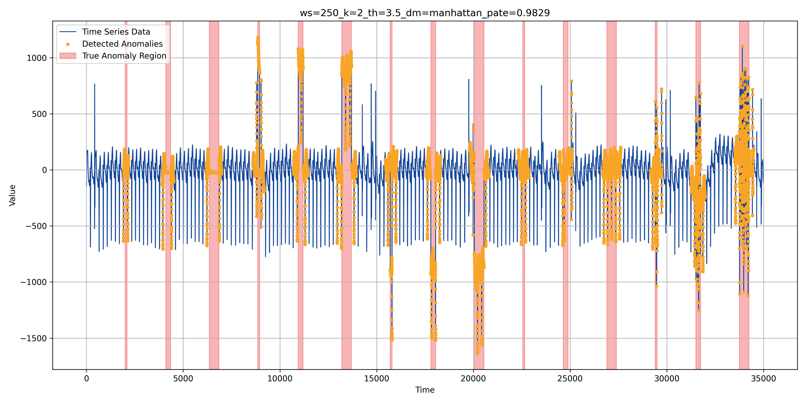
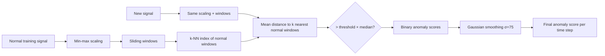
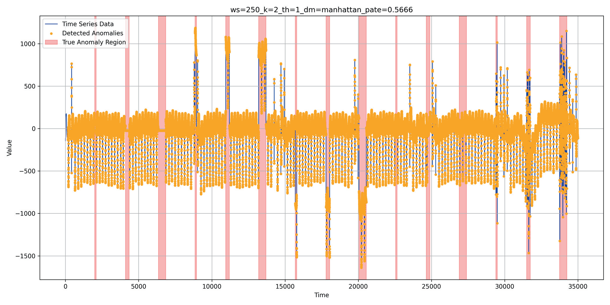
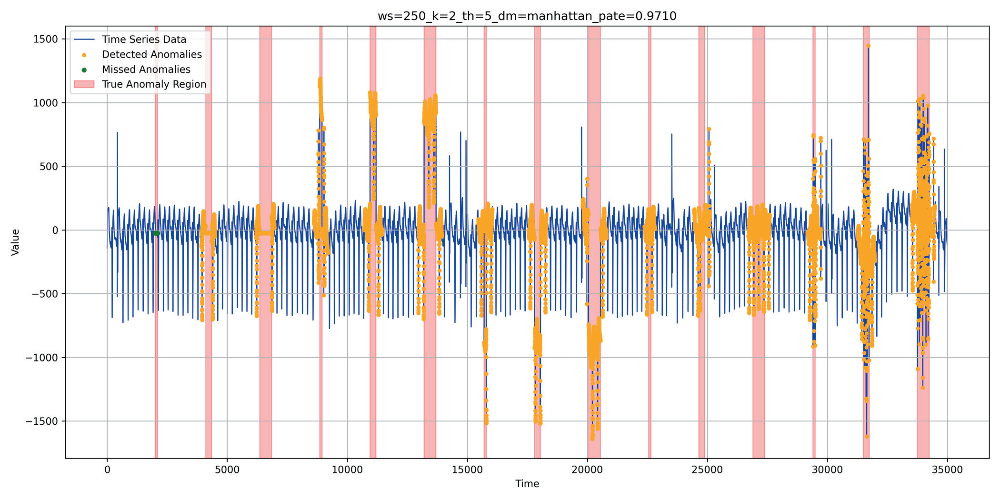
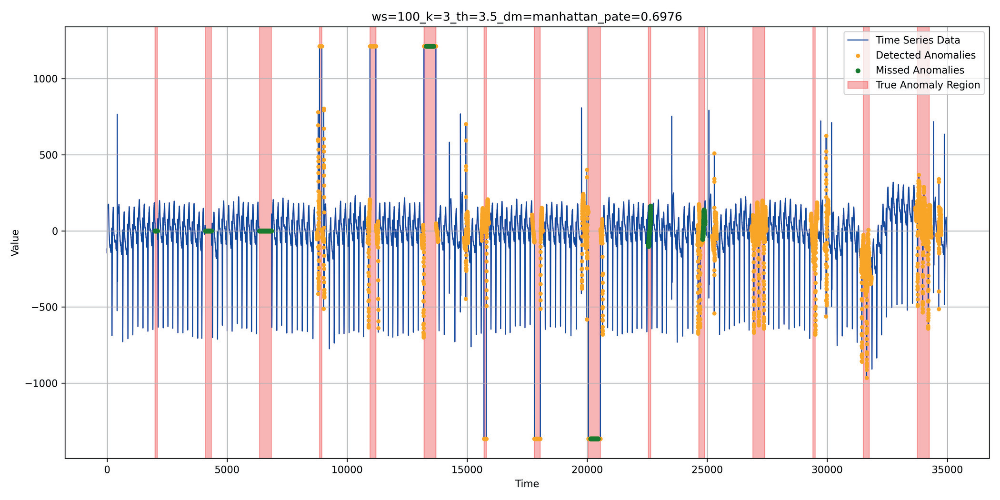
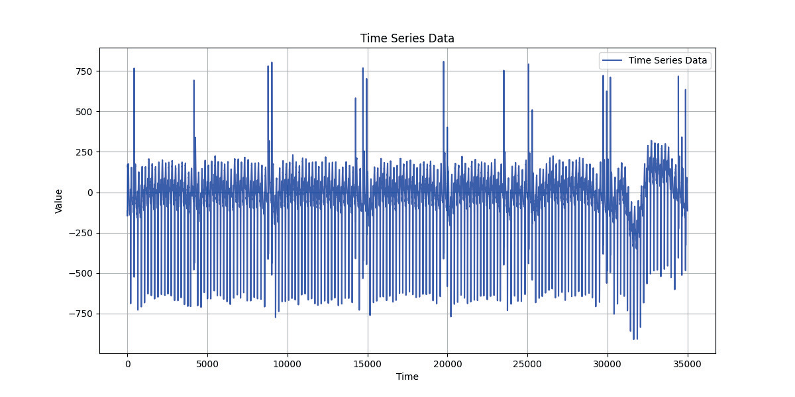
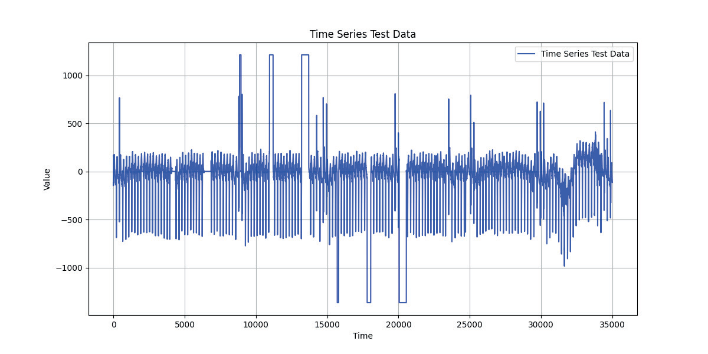
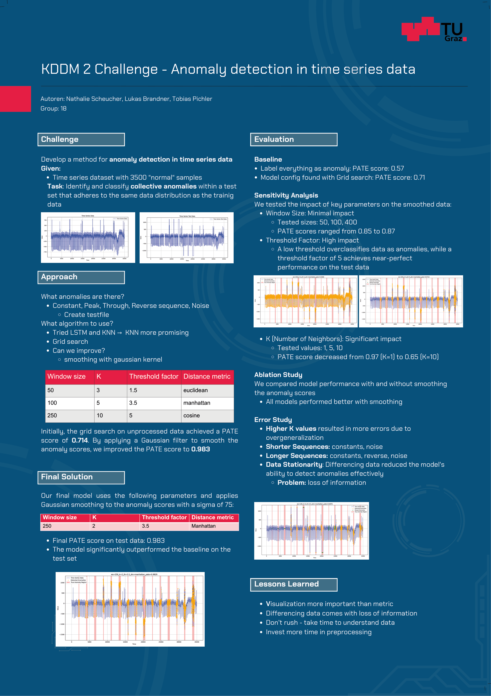

# Time Series Anomaly Detection with k-Nearest Windows

Automatically flags abnormal stretches in a long sensor-style signal: it learns what "normal" looks like and highlights everything that doesn't fit.


<sub>Orange: points flagged by the model · Red bands: true anomaly regions · Final configuration, PATE = 0.983</sub>

## TL;DR

We built an unsupervised detector for **collective anomalies** (whole abnormal sequences, not single outliers) in a univariate time series.
A k-nearest-neighbour model over sliding windows, followed by **Gaussian smoothing of the anomaly scores**, reached a **PATE score of 0.983**. A "flag everything" baseline scores 0.57, and the same model without smoothing scores 0.71.

## Why this matters

Most real systems produce long, repetitive signals and have **no labelled failures** to learn from. The model has to learn "normal" and catch the deviations. This setup is common in practice:

- **Predictive maintenance:** a vibration or pressure sensor that suddenly flatlines (a stuck sensor), spikes or turns noisy before a breakdown.
- **Infrastructure & IT monitoring:** CPU, latency or throughput metrics whose usual daily pattern breaks.
- **Medical & physiological signals:** periodic signals in which a sequence suddenly looks different.
- **Fraud & transaction monitoring:** activity patterns that deviate from an account's usual rhythm.

The anomaly types we targeted are the failure modes seen in these settings: **constant (flatline), peak, trough, reversed sequence and noise**.

## Approach



1. **Generate a labelled test set.** The challenge only provides normal data, so we injected 15 anomalies (5 types × lengths 100 / 250 / 500) into the signal (`create_testdata.py`).
2. **Choose the model.** We tried an LSTM and k-nearest-neighbour (KNN) on sliding windows. KNN was more promising, so we continued with it.
3. **Grid search** over window size, k, threshold factor and distance metric (`parameter_optimization.py`).
4. **Smooth the scores** with a Gaussian kernel. This removes isolated false alarms and fills the gaps inside detected sequences, which was the biggest single improvement.

**Final configuration:** window size 250 · k = 2 · threshold factor 3.5 · Manhattan distance · Gaussian σ = 75

## Results

Metric: **[PATE](https://arxiv.org/abs/2405.12096)** (Proximity-Aware Time series anomaly Evaluation). PATE is built for range-based anomalies: it rewards detections that land in or near the true anomaly region and does not depend on a single cut-off threshold.

| Method | PATE |
|---|---|
| Baseline: label everything as anomaly | 0.57 |
| LSTM | [Platzhalter: score not documented] |
| KNN, best grid-search config (raw scores) | 0.71 |
| **KNN + Gaussian smoothing (final)** | **0.983** |

**Sensitivity analysis** (on smoothed scores):

| Parameter | Tested | Effect on PATE |
|---|---|---|
| Window size | 50, 100, 400 | Minimal: 0.85 – 0.87 |
| k (neighbours) | 1, 5, 10 | Significant: 0.97 (k=1) → 0.65 (k=10) |
| Threshold factor | 1 … 5 | High: 0.567 at factor 1 vs. 0.971 at factor 5 |

| Threshold too low (factor 1): almost everything is flagged | Threshold factor 5: near-perfect detection |
|---|---|
|  |  |

## Key findings

- **Post-processing beat model tuning.** Gaussian smoothing raised PATE from 0.71 to 0.983, and it improved every model we tested (ablation study).
- **The threshold has the largest effect.** A low threshold produces false alarms everywhere. A factor of 5 gives near-perfect detection.
- **Fewer neighbours worked better.** Higher k caused over-generalisation and more errors. Most errors came from constant and noise anomalies, and from reversed sequences when they were long.
- **Look at the data, not only the metric.** Differencing the series to make it stationary removed exactly the information needed to spot extreme peaks and troughs.

<details>
<summary>Error study example (a weaker config: missed anomalies in green)</summary>


</details>

## Data

- **Source:** KDDM 2 course challenge, TU Graz (January 2025). [Platzhalter: original data source / domain of the signal]
- **Type:** univariate, strongly periodic time series containing only normal behaviour
- **Size:** 35,000 time steps (`X_train.csv`)
- **Test data:** generated by injecting 15 labelled collective anomalies (constant, peak, trough, reverse, noise × 3 lengths)

| Training signal (normal only) | Test signal with injected anomalies |
|---|---|
|  |  |

## Tech stack

Python 3.9 · scikit-learn (`NearestNeighbors`, `MinMaxScaler`) · NumPy · pandas · SciPy (`gaussian_filter1d`) · Matplotlib · [PATE](https://pypi.org/project/PATE/) metric · TensorFlow/Keras (LSTM experiments) · PyInstaller (packaged CLI)

## Run it yourself

```bash
git clone https://github.com/syrrex/Time_Series_Anomaly_Detection.git
cd Time_Series_Anomaly_Detection
pip install -r requirements.txt

python train.py                 # fit the KNN model on X_train.csv -> knn_model.joblib, scaler.joblib
python main.py <your_series.csv> # score a new series -> predictions_group_18.csv (one score per time step)
python parameter_optimization.py # grid search, plots + scores written to results/ (git-ignored)
python experiments.py           # smoothing / sensitivity / ablation experiments
```

> Note: `train.py` / `main.py` use the hand-in configuration (window 350, k = 3, threshold 2.5, moving-average smoothing). The poster's final configuration (window 250, k = 2, threshold 3.5, Gaussian σ = 75) is in `run_experiment_1` in `experiments.py`.

## Repository structure

```
├── main.py                    # CLI: score a CSV time series with the trained model
├── train.py                   # sliding-window KNN training
├── test.py                    # scoring, threshold logic, smoothing, baseline
├── create_testdata.py         # inject constant / peak / trough / reverse / noise anomalies
├── parameter_optimization.py  # grid search over window size, k, threshold, metric
├── experiments.py             # smoothing, sensitivity, ablation & stationarity experiments
├── plots.py                   # visualisation of detections vs. ground truth
├── X_train.csv                # training data (normal behaviour only)
├── main.spec                  # PyInstaller build spec
├── assets/                    # figures used in this README
└── poster.pdf                 # project poster
```

## Poster

[](poster.pdf)

📄 [Open the poster (PDF)](poster.pdf)

---

Lukas Brandner, Nathalie Scheucher and Tobias Pichler (KDDM 2, TU Graz).
